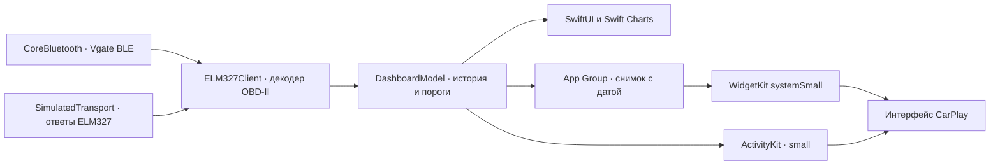

# Архитектура CarGauge

`CarGaugeCore` — Swift Package без зависимости от iOS SDK. Он содержит протокол транспорта, фрейминг по приглашению `>`, декодер, клиент ELM327, проверку свежести и гистерезис. CLI и SwiftUI используют один симулятор. BLE и модель интерфейса изолированы на `MainActor`. Виджет и Live Activity отображают данные, полученные от приложения.

Транспорт сканирует периферию по известным признакам, предлагает пользователю выбрать адаптер и сохраняет его UUID. Первое подключение использует экземпляр, найденный при сканировании. Для повторного подключения транспорт пробует восстановить экземпляр по UUID. Если объекта нет в кеше CoreBluetooth, транспорт ищет устройство с этим UUID по GATT-сервисам. Основной кандидат для Vgate — `18F0/2AF0/2AF1`, дополнительно предусмотрены `FFF0/FFF1/FFF2` и `FFE0/FFE1`. Если характеристики одного из найденных профилей не подходят, транспорт проверяет следующий. Версию прошивки и фактический GATT-профиль нужно сверить на устройстве.

Клиент выполняет `ATZ, ATE0, ATL0, ATS0, ATH0, ATSP0`. Первая команда `0105` получает до 15 секунд на поиск OBD-протокола. Дальше клиент читает температуру первой в каждом цикле и сразу отдаёт её интерфейсу. Затем он опрашивает обороты и напряжение. Следующий цикл начинается спустя секунду после завершения предыдущего. BLE-пакеты могут делить ответ в любом месте. Следующая команда отправляется после `>` и подтверждения GATT-записи, если оно требуется. После тайм-аута или разрыва транспорт закрывается и создаётся заново. С включённым автоподключением повторные попытки идут через 1, 2, 4, 8, 16 и затем 30 секунд.

| Команда | Показание | Декодирование |
| --- | --- | --- |
| `0105` | Температура ОЖ | `A − 40` °C |
| `010C` | Обороты двигателя | `(256A + B) / 4` об/мин |
| `0142` | Напряжение на ECU | `(256A + B) / 1000` В |
| `ATRV` | Напряжение по адаптеру | Строка ELM327 в вольтах. Резерв для сеанса при отсутствии пригодного ответа `0142`. |

Каждое показание имеет свою дату. После пяти секунд без измерения экран iPhone скрывает значение. Состояние предупреждения снимается только по новому показанию ниже соответствующего порога с гистерезисом 3 °C. Пороги 105 и 115 °C выбраны для прототипа. Температура и график хранятся в памяти текущего сеанса, максимум 30 минут и 1800 точек. На графике есть разрывы между участками без показаний. Для автомобиля можно разрешить локальные уведомления о переходах между уровнями предупреждения.

Приложение атомарно пишет снимок температуры в контейнер App Group при смене уровня предупреждения и примерно раз в минуту. WidgetKit получает дату замера и запись об истечении срока через 15 минут. Live Activity получает температуру примерно раз в восемь секунд и при смене уровня предупреждения. Срок свежести Live Activity — 20 секунд от последнего переданного замера.
