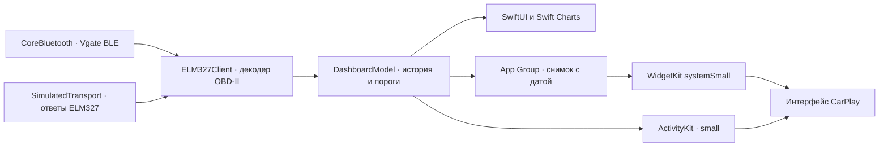

# Архитектура CarGauge

`CarGaugeCore` — Swift Package без зависимости от iOS SDK. Он содержит протокол транспорта, фрейминг по приглашению `>`, декодер, клиент ELM327, проверку свежести и гистерезис. CLI и SwiftUI используют один симулятор. BLE и модель интерфейса изолированы на `MainActor`. Виджет и Live Activity отображают данные, полученные от приложения.

Транспорт предлагает пользователю выбрать адаптер и сохраняет его UUID. Для переподключения сначала проверяются подключённые устройства и кэш CoreBluetooth. При промахе или неответившем устройстве начинается сканирование по тому же UUID. В активном приложении видны и устройства без рекламируемых GATT-сервисов. Кандидаты транспорта — `18F0/2AF0/2AF1`, `FFF0/FFF1/FFF2` и `FFE0/FFE1`. Он проверяет свойства характеристик перед записью и при неизвестном профиле показывает найденные UUID. Версию прошивки и фактический GATT-профиль нужно сверить на устройстве.

Клиент выполняет `ATZ, ATE0, ATL0, ATS0, ATH0, ATSP0`. Первая команда `0105` получает до 15 секунд на поиск OBD-протокола и возвращает первый замер сразу. Дальше после температуры опрашиваются обороты и напряжение. Циклы разделены паузой в одну секунду. BLE-пакеты могут делить ответ в любом месте. Следующая команда отправляется после `>` и подтверждения GATT-записи, если оно требуется. При обрыве или тайм-ауте следующий сеанс использует новый транспорт.

Автоподключение предусмотрено при холодном запуске и при возврате из фона. В активном приложении доступны четыре повтора с паузами 1, 2, 4 и 8 секунд. Десять успешно завершённых циклов восстанавливают бюджет. В фоне опрос также останавливается после 30 минут исполнения, если iOS оставляет процесс активным. Свежие нулевые обороты после зафиксированной работы двигателя останавливают опрос через 15 секунд. Оператор может возобновить измерения кнопкой Play или открыть приложение снова после фона.

| Команда | Показание | Декодирование |
| --- | --- | --- |
| `0105` | Температура ОЖ | `A − 40` °C |
| `010C` | Обороты двигателя | `(256A + B) / 4` об/мин |
| `0142` | Напряжение на ECU | `(256A + B) / 1000` В |
| `ATRV` | Напряжение по адаптеру | Строка ELM327 в вольтах. Резерв для сеанса при отсутствии пригодного ответа `0142`. |

Каждое показание имеет свою дату. После пяти секунд без измерения экран iPhone скрывает значение. Состояние предупреждения снимается только по новому показанию ниже соответствующего порога с гистерезисом 3 °C. Пороги 105 и 115 °C выбраны для прототипа. Температура и график хранятся в памяти текущего сеанса, максимум 30 минут и 1800 точек. На графике есть разрывы между участками без показаний. Для автомобиля можно разрешить локальные уведомления о переходах между уровнями предупреждения.

Приложение атомарно пишет снимок температуры в контейнер App Group при смене уровня предупреждения и примерно раз в минуту. WidgetKit получает дату замера и запись об истечении срока через 60 секунд. По разрешению пользователя Full запускает Live Activity на первом свежем замере на переднем плане. Температура в ней обновляется примерно раз в восемь секунд и при смене уровня предупреждения. При обрыве активность помечается устаревшей, при окончании сеанса она завершается. Срок свежести последнего переданного замера — 20 секунд.

## Подключение и обновление 0.4.0

Слой BLE держит выбранный на экране поиска UUID в памяти до завершения проверки. После GATT, инициализации ELM327 и первого свежего PID `0105` Dashboard сохраняет проверенный UUID и доступное имя. UUID из 0.3.0 используется для повторного поиска и становится подтверждённым после первой проверки. Отмена или неудачная смена сохраняет ранее проверенный выбор. Сброс удаляет только настройки адаптера.

Плановое ограничение опроса в фоне составляет 30 минут, для одной непрерывной сессии в открытом приложении — четыре часа. Отдельное состояние стоянки появляется только после подтверждённых свежих нулевых оборотов. При возвращении приложение проверяет сохранённый адаптер в пределах бюджета. Поиск новых устройств запускается явным действием и завершается через 15 секунд или при закрытии экрана.

App Group используется только для файлового снимка виджета. Live Activity получает ContentState через ActivityKit. В Release тестовый транспорт и его аргументы исключены при сборке, а сохранённый снимок Debug отвергается виджетом.
