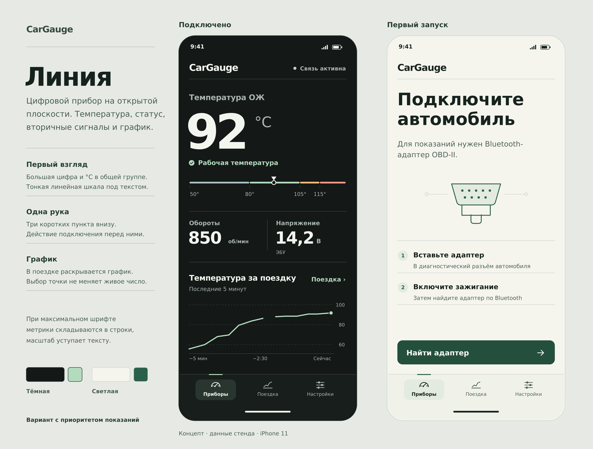
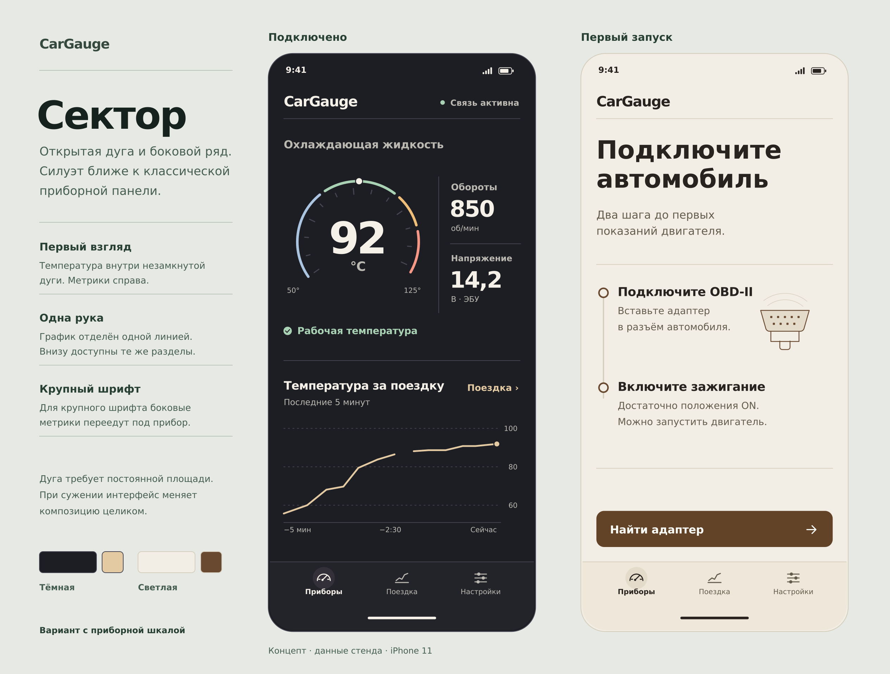
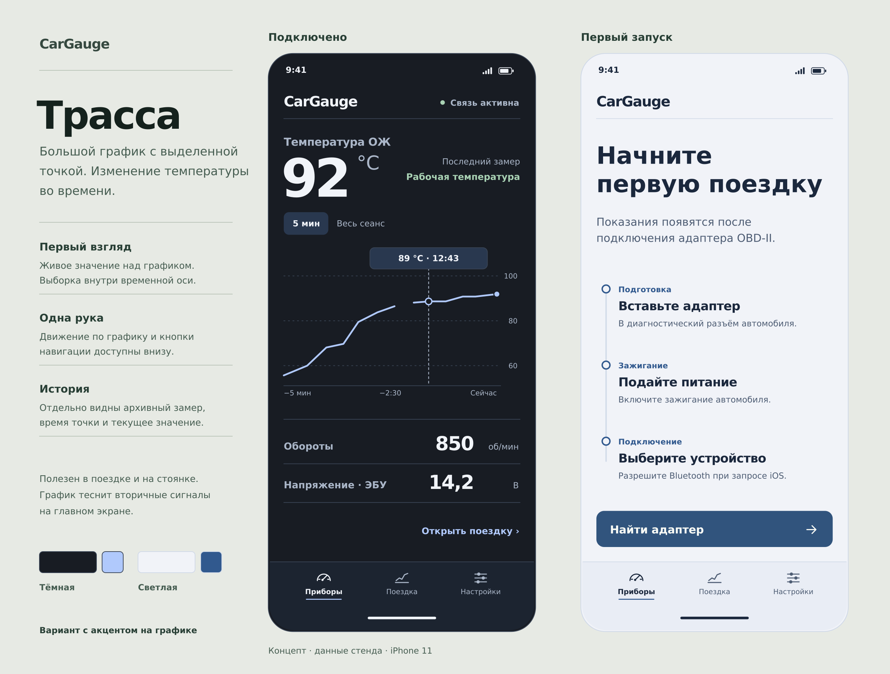

# Три направления CarGauge

Все три концепта используют одну сцену на iPhone 11. Температура 92 °C, обороты 850 об/мин и напряжение ЭБУ 14,2 В позволяют сравнить приоритеты без изменения исходных данных. Рядом показано состояние первого запуска. Это вручную собранные концепт-борды с данными стенда. Фактические кадры приложения проверяются отдельно в XCTest.

## Линия

Открытая плоскость с одним крупным числом. Градусы относятся к числу, подпись состояния располагается отдельно под ним. Настраиваемые пороги отмечены на горизонтальной шкале, две вторичные метрики занимают один ряд с тонким разделителем. Ниже располагается компактный график с разрывами и переходом в поездку. При первом запуске эта же сетка отводит высоту заголовку, двум шагам и одной доступной снизу кнопке.

Графит `#141817` и фарфор `#F5F5EE`. Свежая телеметрия остаётся самым контрастным элементом. Зелёный сообщает рабочее состояние, янтарный предупреждает, тёплый красный сигнализирует о перегреве. Названия состояний и форма маркера сохраняют смысл без цвета.

## Сектор

В салоне заметен знакомый силуэт прибора. Незамкнутая дуга и крупное показание слева уравновешены правым рядом вторичных метрик. График занимает полную ширину ниже. Первый запуск строится как последовательность подключения с двумя большими шагами.

На меньшей ширине сектор и боковые метрики конкурируют за место. При очень крупном шрифте боковой ряд приходится переносить под прибор. Структурно это родственник старой дуги, поэтому отличие заметно прежде всего в распределении метрик, а не в ритуале считывания показаний.

## Трасса

Экран сначала показывает последнее значение и затем предлагает исследовать его во времени. У графика виден срез с временем и температурой. Вторичные сигналы образуют короткий ряд показаний под графиком, подключение показано как подготовка первой поездки. Вариант раскрывает ценность истории после стоянки. На ходу график требует больше внимания, а обороты и напряжение оказываются ниже.

## Сравнение

Оценка автора концептов по единому сценарию. Шкала от 1 до 5, веса отражают приоритет панели приборов. Время взгляда на физическом устройстве этим сравнением не измерялось.

| Критерий | Вес | Линия | Сектор | Трасса |
| --- | ---: | ---: | ---: | ---: |
| Температура считывается первой | 35% | 5 | 4 | 3 |
| Адаптация к крупному шрифту | 25% | 5 | 2 | 4 |
| Навигация и действие одной рукой | 20% | 5 | 4 | 4 |
| Выразительная композиция | 10% | 4 | 5 | 4 |
| Исследование истории | 10% | 4 | 4 | 5 |
| Взвешенная оценка | | **4,80** | **3,60** | **3,75** |

Для приборов предпочтительна **Линия**. Её иерархия сохраняется при переносах текста и при смене темы. Из Трассы можно взять поведение подробного графика на экране поездки. Точка графика относится к истории и не меняет живое число. Из Сектора полезен принцип «позиция плюс текст» для состояния температуры.

| Было в `89991d3` | Направление Линии |
| --- | --- |
| Цифра внутри крупной дуги задаёт высоту первого блока. | Открытая цифра с небольшой линейной шкалой. Выше видны метрики и вход в график. |
| Заголовок панели и состояние подключения делят верхнюю строку. | Подключение остаётся в верхней строке, состояние температуры находится рядом с числом. |
| График панели открывает поездку, исторический график читается как сводка. | Панель сохраняет быстрый вход. В поездке пользователь выбирает точку и получает конкретный исторический замер. |
| Три раздела уже доступны снизу. | Сохранить знакомые названия, порядок и безопасную область. Поместить основные действия подключения над навигацией. |

## Экранная система

| Экран или состояние | Композиция и поведение |
| --- | --- |
| Приборы со свежими данными | Температура и статус крупнее двух остальных показаний. Значение движется только по новым валидным отсчётам. Источник напряжения рядом с единицей или в подписи. |
| Первый запуск | Коротко объяснить роль OBD-II, показать шаги «Вставьте адаптер» и «Включите зажигание». Назначить одну кнопку «Найти адаптер». |
| Поиск и выбор | Нативная панель с узнаваемым закрытием. Состояния поиска и пустого списка не занимают места одновременно. Предполагаемые OBD-адаптеры отделены от остальных. Отображаются фактические имена и ID при совпадении. |
| Подключение и восстановление | Строка связи уточняет фазу. При ожидании обозначить, что нужен первый замер, и не рисовать нули. При разрыве выводятся понятное действие и последняя валидная история с разрывом. |
| Ошибка или потеря доступа | Пояснить, требуется ли включить Bluetooth, выдать разрешение или запитать адаптер. Основное действие доступно одной рукой, смена адаптера остаётся вторичной. |
| Двигатель выключен | Явное состояние остановки. История последнего сеанса остаётся доступной, повтор измерений запускается по явному действию или существующей политике модели. |
| Поездка | Зона графика с тактильным откликом только при смене выбранного отсчёта. Подпись времени и температуры располагается рядом с графиком и доступна VoiceOver. Пустой экран указывает, что нужно подключиться и получить первый замер. |
| Настройки | Однотипные строки и группы. Вверху подключение и тема, далее пороги, предупреждения, Live Activity и переход к диагностике. Для разрушительных действий используется штатное подтверждение. |
| Диагностика | Доступна из настроек. Данные о BLE и ELM раскрываются по смысловым группам с явным отсутствием значения. |

Числа используют стабильную ширину цифр и масштаб Dynamic Type. При дефиците ширины метрики располагаются вертикально. Действия имеют области нажатия от 44 × 44 пт. При Reduce Motion достаточно смены состояния без движения маркера. Для графика требуется доступный способ чтения выбранного замера помимо перетаскивания. [Apple HIG Accessibility](https://developer.apple.com/design/human-interface-guidelines/accessibility) · [Apple HIG VoiceOver](https://developer.apple.com/design/human-interface-guidelines/voiceover)

## Брифы для Stitch

Локальные материалы SwiftUI Pro и SwiftUI UI Patterns использованы для границ состояний и доступа. Stitch Skill `enhance-prompt` использован для подготовки трёх брифов. Каждый бриф передаёт только дизайнерскую сцену и демонстрационные значения. [Stitch — руководство по промптам](https://stitch.withgoogle.com/docs/learn/prompting/)

Общая часть. Создай два экрана в портретном кадре 414 × 896 пт. Первый экран подключён, тёмная тема, 92 °C, 850 об/мин, 14,2 В. Второй экран показывает первый запуск в светлой теме без показаний. Системная типографика iOS, нижняя навигация «Приборы», «Поездка», «Настройки», безопасная область сверху и снизу. Избегай градиентов, лишних бейджей и наборов карточек. Дай центральному числу абсолютный приоритет, подпиши тепловое состояние.

- **Линия.** Открытая типографическая композиция, непрерывная сетка слева. Фарфоровая и графитовая поверхности. Под числом тонкая сегментированная шкала с видимой засечкой. Под ней две метрики и график с настоящим разрывом данных. Первый запуск содержит два практических шага и заметную кнопку поиска в зоне большого пальца.
- **Сектор.** Незамкнутая аналоговая дуга слева, метрики в вертикальном ряду справа, график ниже через один разделитель. Графит и тёплый камень. В светлом состоянии показать процесс подключения как последовательность из двух шагов.
- **Трасса.** Экран строится вокруг графика, показывающего прогрев. Над графиком — последнее живое значение, внутри — отдельная подсказка выбранного исторического отсчёта. Графит и холодная бумага. Первый запуск показывает три шага от подготовки до выбора адаптера.

## Независимый выбор

Ревьюер сначала осмотрел реальные кадры исходной версии и задал веса. Чтение с первого взгляда получило 30%, управление одной рукой 25%, темы, крупный шрифт и состояния 20%, работа с историей 15%, выразительность и риск реализации 10%.

| Концепт | Чтение | Одна рука | Состояния | История | Реализация | Итог из 100 |
|---|---:|---:|---:|---:|---:|---:|
| Линия | 9,5 | 9 | 9 | 8,5 | 9 | **90,75** |
| Трасса | 7,5 | 8 | 7 | 9,5 | 8,5 | 79,25 |
| Сектор | 8 | 8,5 | 6,5 | 7,5 | 7,5 | 77 |

«Линия» даёт температуре первый уровень и освобождает место для оборотов, напряжения и графика. Кнопка первого подключения уходит к нижней навигации. «Сектор» расходует ширину на дугу и требует больше перестроений при крупном шрифте. «Трасса» подходит для изучения поездки, поэтому в экран истории вошли курсор реального замера, его температура и время.

## Референс Google Stitch

Master отправил отдельный синтетический brief для «Линии». Выгрузка PNG и HTML прошла. В приложении использована идея оттенков графита и латуни. Блоки с вымышленным состоянием термостата, давлением, скоростью CAN и кнопками диагностики оставлены на референсе. У реального приложения эти данные и действия не появились. [Сгенерированный референс](stitch-reference.png)

В SwiftUI выбраны семантические цвета, переход числа с учётом Reduce Motion и отклик на выбор вкладки или соседнего замера. График сохраняет отдельные сегменты и доступен через нативный выбор точек и кнопки. [Apple HIG Charts](https://developer.apple.com/design/human-interface-guidelines/charts) · [SwiftUI SensoryFeedback](https://developer.apple.com/documentation/swiftui/sensoryfeedback)
